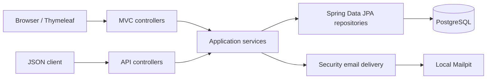

<div align="center">

# Appliance Store

### A full-stack Java pet project for an online appliance shop

Browse products. Manage accounts. Build and approve orders.


[Overview](#overview) · [Screenshots](#screenshots) · [Features](#features) · [Architecture](#architecture) · [Run locally](#run-locally) · [Testing](#testing)

</div>

---

## Overview

Appliance Store is my main Java pet project: a storefront and staff workspace built around a Spring Boot backend. It brings together product browsing, customer accounts, order processing and account security in one application.

The project started from an EPAM Spring Boot exercise and was extended with database authentication, JWT and refresh-token flows, Google sign-in, email verification, a redesigned storefront and PostgreSQL integration tests. The web interface uses server-rendered Thymeleaf pages with JavaScript for interactive forms; an optional JSON API provides a separate integration surface.

## Screenshots


## Features

| Area | What I implemented |
| --- | --- |
| **Storefront** | Product cards, detail pages, image galleries and responsive navigation. |
| **Catalog discovery** | Server-side search, pagination and sorting, with bounded lookup requests for forms. |
| **Account management** | Client and employee management, normalized inputs, validation and duplicate handling. |
| **Orders** | Multiple product rows, quantities, server-calculated totals, editing, deletion and employee approval. |
| **Authorization** | Client/employee roles, order ownership checks and server-side access enforcement. |
| **Password authentication** | Database accounts, BCrypt passwords, failed-login limits and localized sign-in errors. |
| **Token lifecycle** | JWT browser cookies, rotating refresh tokens, replay rejection and credential revocation. |
| **Google sign-in** | Optional OAuth2 / OpenID Connect login, client onboarding and explicit account linking. |
| **Email workflows** | Client registration, email verification, password recovery and security notifications through local Mailpit. |
| **Localization** | Ukrainian and English pages, forms, validation messages and error responses. |
| **JSON API** | Optional API controllers, DTO contracts and localized Problem Detail errors. |
| **Observability** | Request correlation IDs, rotating logs and transaction-aware business events without credential logging. |

### User roles

| Capability | Client | Employee |
| --- | :---: | :---: |
| Browse products and manufacturers | ✓ | ✓ |
| Create and manage permitted orders | Own orders | Managed orders |
| Approve orders | — | ✓ |
| Manage products and manufacturers | — | ✓ |
| Manage client and employee accounts | — | ✓ |
| Change own password and manage Google linking | ✓ | ✓ |

## Technology stack

| Layer | Technologies |
| --- | --- |
| **Backend** | Java 17, Spring Boot, Spring MVC, Spring Security, Bean Validation, Spring AOP |
| **Web UI** | Thymeleaf, HTML, CSS, JavaScript |
| **Persistence** | PostgreSQL, Spring Data JPA, Hibernate, Flyway |
| **Mapping** | MapStruct, Lombok |
| **Authentication** | BCrypt, JWT, refresh tokens, Google OAuth2 / OpenID Connect |
| **Local infrastructure** | HTTPS, Docker Compose, Mailpit |
| **Testing** | JUnit, Mockito, MockMvc, H2, PostgreSQL Testcontainers, JaCoCo |
| **Build** | Maven and Maven Wrapper |

## Architecture



| Responsibility | Packages |
| --- | --- |
| HTML routes and shared MVC advice | `controller`, `web` |
| JSON endpoints and API errors | `api` |
| Business operations and policies | `service` |
| Entities and database access | `model`, `repository`, `persistence` |
| Input/output contracts and conversion | `dto`, `mapper`, `validation` |
| Authentication and authorization | `security` |
| Email, logging and configuration | `mail`, `logging`, `config` |

### Engineering decisions

| Decision | Purpose |
| --- | --- |
| **Service-owned business rules** | Keep controllers focused on HTTP handling and presentation. |
| **Server-authoritative validation and totals** | Enforce order rules even when requests bypass the UI. |
| **DTOs and generated MapStruct mappings** | Separate web contracts from persistence entities. |
| **Transactional operations and account locking** | Coordinate sensitive writes and competing account/order operations. |
| **Flyway migrations with Hibernate validation** | Keep schema changes explicit and reproducible. |
| **Cookie security and CSRF protection** | Protect browser authentication and state-changing requests. |
| **Isolated test infrastructure** | Exercise PostgreSQL behavior without modifying the local application database. |

## Run locally

Requirements: JDK 17, PostgreSQL and Docker Desktop running Linux containers. Run commands from the project root.

Create a PostgreSQL database named `appliance_store` and configure its connection through environment variables:

```text
SPRING_PROFILES_ACTIVE=local
DB_URL=jdbc:postgresql://localhost:5432/appliance_store
DB_USERNAME=postgres
DB_PASSWORD=<your database password>
JWT_SECRET_BASE64=<Base64-encoded random key of at least 32 bytes>
SSL_KEY_STORE_PASSWORD=<your local keystore password>
```

Generate a random JWT key in PowerShell:

```powershell
$jwtKey = New-Object byte[] 32
$rng = [System.Security.Cryptography.RandomNumberGenerator]::Create()
$rng.GetBytes($jwtKey)
$rng.Dispose()
[Convert]::ToBase64String($jwtKey)
```

Create the local HTTPS certificate once, choosing the keystore password used above:

```powershell
powershell -ExecutionPolicy Bypass -File .\scripts\setup-local-https.ps1 -TrustCertificate
```

`-TrustCertificate` adds the development certificate to the current Windows user's trusted certificates. The keystore is stored under `config/certs/` and excluded from Git. Keep passwords and keys in the launch environment.

Start the application:

```powershell
.\mvnw.cmd spring-boot:run
```

Open **https://localhost:8443**. HTTP GET/HEAD requests on port 8080 redirect to HTTPS; HTTP write requests are rejected.

The `local` profile starts Mailpit through Docker Compose. SMTP listens at `127.0.0.1:1025`; the inbox is available at **http://127.0.0.1:8025**. Mailpit remains running when the application stops. Only local email delivery is configured.

```powershell
docker compose ps
docker compose stop mailpit
```

Flyway applies common schema migrations and local demo data. Hibernate validates the schema; SQL initialization and automatic schema generation are disabled. Start with an empty application database. Preserve applied versioned migrations and add a new migration for subsequent schema changes.

## Demo accounts

The local/test seed includes these disposable accounts:

| Role | Email | Password |
| --- | --- | --- |
| Client | mercury@gmail.com | `MercuryLocal2026!` |
| Employee | phobos@gmail.com | `PhobosLocal2026!` |

The normal authentication mode reads accounts from the database. Optional in-memory authentication is configured separately through `config/auth-inmemory.properties.example`.

## Optional Google sign-in

Create a Google OAuth client of type Web application and register this redirect URI:

```text
https://localhost:8443/login/oauth2/code/google
```

Set the following variables in the application launch environment:

```text
GOOGLE_LOGIN_ENABLED=true
GOOGLE_CLIENT_ID=<your client ID>
GOOGLE_CLIENT_SECRET=<your client secret>
```

Google sign-in is disabled by default. New users complete a client profile; an existing local account must explicitly link its Google identity. Email verification uses Mailpit where required.

## Optional JSON API

Enable the API with `store.api.enabled=true`. API controllers return JSON and localized `application/problem+json` errors. The default cookie transport shares the browser login and retains CSRF protection. Browser authentication uses JWT by default; an explicit session mode is available for session-policy demonstrations and regression tests.

## Testing

Ordinary tests use the `test` profile and isolated H2 databases. They do not require local database credentials, a personal certificate or Mailpit.

```powershell
.\mvnw.cmd test
.\mvnw.cmd -Punit-tests test
```

Run the complete verification, including PostgreSQL Testcontainers and coverage checks, with Docker Desktop running:

```powershell
.\mvnw.cmd clean verify -Pcontainer-tests
```

PostgreSQL tests use disposable containers rather than the local application database. The coverage report is generated at `target/site/jacoco/index.html`; models are included, and the global checks require zero missed lines and branches. Coverage measures executed code and does not guarantee every possible scenario.


## Logging

Local logs are written to the console and `logs/store.log`, with rotation. Each request has an `X-Request-ID` for correlation. Credentials, tokens, cookie values and request bodies are excluded from logs.

## Project scope

This is a portfolio and learning project designed to demonstrate backend architecture and complete application workflows. Local email delivery uses Mailpit. Google login requires personal OAuth client configuration. Automated OIDC tests use synthetic identities; a real Google login is a separate manual check.

Product images are bundled for the demonstration catalog; source information is recorded in [`docs/catalog-image-sources.json`](docs/catalog-image-sources.json).
